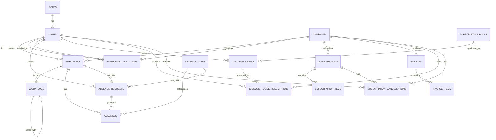

# Tiemply API - Data Model Documentation

## Table of Contents
- [Overview](#overview)
- [Entity Relationship Diagram](#entity-relationship-diagram)
- [Entities](#entities)
  - [User](#user)
  - [Role](#role)
  - [Company](#company)
  - [Employee](#employee)
  - [WorkLog](#worklog)
  - [AbsenceType](#absencetype)
  - [Absence](#absence)
  - [AbsenceRequest](#absencerequest)
  - [TemporaryInvitation](#temporaryinvitation)
- [Billing & Subscription Entities](#billing--subscription-entities)
  - [SubscriptionPlan](#subscriptionplan)
  - [Subscription](#subscription)
  - [SubscriptionItem](#subscriptionitem)
  - [Invoice](#invoice)
  - [InvoiceItem](#invoiceitem)
  - [DiscountCode](#discountcode)
  - [DiscountCodeRedemption](#discountcoderedemption)
  - [SubscriptionCancellation](#subscriptioncancellation)
- [System Entities](#system-entities)
  - [SystemSetting](#systemsetting)

---

## Overview

Tiemply API es un sistema de gestión de tiempo y asistencia que maneja múltiples empresas, empleados, registros de trabajo y ausencias. El sistema implementa un modelo basado en roles y soporta geolocalización para el registro de entradas y salidas.

---

## Entity Relationship Diagram



---

## Entities

### User

**Table Name:** `users`

**Description:** Representa a los usuarios del sistema. Un usuario puede tener múltiples registros de empleados en diferentes empresas.

#### Fields

| Field | Type | Nullable | Default | Description |
|-------|------|----------|---------|-------------|
| id | UUID | No | - | Primary key |
| uuid | UUID | No | Auto | UUID for external identification |
| name | VARCHAR(255) | No | - | Full name of the user |
| email | VARCHAR(255) | No | - | Email address (unique) |
| password | VARCHAR(255) | No | - | Hashed password |
| identification_number | VARCHAR(255) | Yes | NULL | DNI/ID number |
| birth_date | DATE | Yes | NULL | Date of birth |
| phone | VARCHAR(255) | Yes | NULL | Phone number |
| address | VARCHAR(255) | Yes | NULL | Physical address |
| locale | VARCHAR(10) | Yes | 'es' | User's preferred language |
| role_id | UUID | Yes | NULL | Foreign key to roles |
| registered_at | TIMESTAMP | Yes | CURRENT_TIMESTAMP | Registration timestamp |
| email_verified_at | TIMESTAMP | Yes | NULL | Email verification timestamp |
| remember_token | VARCHAR(100) | Yes | NULL | Laravel remember token |
| created_at | TIMESTAMP | No | - | Creation timestamp |
| updated_at | TIMESTAMP | No | - | Last update timestamp |

#### Indexes

| Name | Type | Columns |
|------|------|---------|
| PRIMARY | Primary | id |
| users_email_unique | Unique | email |

#### Foreign Keys

| Column | References | On Delete |
|--------|------------|-----------|
| role_id | roles(id) | SET NULL |

#### Relationships

```php
// Eloquent Relationships
role()              // BelongsTo Role
employeeRecords()   // HasMany Employee
companies()         // HasManyThrough Company (via Employee)
companiesEloquent() // HasManyThrough Company (alternative method)
```

#### Important Methods

```php
hasRole(string $roleName): bool                // Check if user has specific role
belongsToCompany(string $companyId): bool      // Check if user belongs to company
isAdmin(): bool                                 // Check if user is administrator
isManager(): bool                               // Check if user is manager
canAccessPanel(Panel $panel): bool             // Filament panel access check
getLocale(): string                             // Get user's locale
setLocale(string $locale): bool                 // Set user's locale
```

#### Notes
- Uses `HasUuid` trait for UUID generation
- Implements `FilamentUser` for Filament panel access
- Password is automatically hashed via casting

---

### Role

**Table Name:** `roles`

**Description:** Define los roles del sistema (Administrator, Manager, Employee) con niveles de acceso y permisos específicos.

#### Fields

| Field | Type | Nullable | Default | Description |
|-------|------|----------|---------|-------------|
| id | UUID | No | - | Primary key |
| uuid | UUID | No | Auto | UUID for external identification |
| name | VARCHAR(255) | No | - | Role name (Administrator, Manager, Employee) |
| description | TEXT | Yes | NULL | Role description |
| is_exempt | BOOLEAN | No | false | If true, exempt from time tracking |
| access_level | INTEGER | No | 1 | Numeric access level (higher = more access) |
| created_at | TIMESTAMP | No | - | Creation timestamp |
| updated_at | TIMESTAMP | No | - | Last update timestamp |

#### Indexes

| Name | Type | Columns |
|------|------|---------|
| PRIMARY | Primary | id |

#### Relationships

```php
// Eloquent Relationships
users()  // HasMany User
```

#### Important Methods

```php
isAdmin(): bool                       // Check if role is Administrator
isManager(): bool                     // Check if role is Manager
isEmployee(): bool                    // Check if role is Employee
isExempt(): bool                      // Check if exempt from time tracking
hasAccessLevel(int $level): bool      // Check minimum access level
```

#### Notes
- Common roles: Administrator, Manager, Employee
- Access levels determine permissions hierarchy

---

### Company

**Table Name:** `companies`

**Description:** Representa una empresa en el sistema. Cada empresa puede tener múltiples empleados y configuraciones específicas de vacaciones y geolocalización. También gestiona suscripciones y facturación a través de Stripe.

#### Fields

| Field | Type | Nullable | Default | Description |
|-------|------|----------|---------|-------------|
| id | UUID | No | - | Primary key |
| uuid | UUID | No | Auto | UUID for external identification |
| name | VARCHAR(255) | No | - | Company name |
| tax_id | VARCHAR(255) | No | - | Tax ID / CIF (unique) |
| contact_email | VARCHAR(255) | No | - | Contact email |
| contact_person | VARCHAR(255) | No | - | Contact person name |
| address | VARCHAR(255) | No | - | Company address |
| phone | VARCHAR(255) | No | - | Company phone |
| vacation_type | ENUM | No | 'business_days' | Type of vacation days (business_days, calendar_days) |
| max_vacation_days | INTEGER | No | 22 | Maximum vacation days per year |
| geolocation_enabled | BOOLEAN | No | false | Enable geolocation features |
| geolocation_required | BOOLEAN | No | false | Require geolocation for check-in/out |
| geolocation_radius | DECIMAL(8,2) | Yes | NULL | Allowed radius in meters |
| office_latitude | DECIMAL(12,9) | Yes | NULL | Office latitude coordinate |
| office_longitude | DECIMAL(12,9) | Yes | NULL | Office longitude coordinate |
| office_address | VARCHAR(255) | Yes | NULL | Office address |
| stripe_id | VARCHAR(255) | Yes | NULL | Stripe customer ID |
| pm_type | VARCHAR(255) | Yes | NULL | Payment method type |
| pm_last_four | VARCHAR(4) | Yes | NULL | Last 4 digits of payment method |
| trial_ends_at | TIMESTAMP | Yes | NULL | Trial period end date |
| billing_name | VARCHAR(255) | Yes | NULL | Billing name |
| billing_address | VARCHAR(255) | Yes | NULL | Billing address |
| billing_city | VARCHAR(255) | Yes | NULL | Billing city |
| billing_postal_code | VARCHAR(255) | Yes | NULL | Billing postal code |
| billing_country | VARCHAR(2) | Yes | NULL | Billing country ISO code |
| logo_path | VARCHAR(255) | Yes | NULL | Company logo file path |
| created_at | TIMESTAMP | No | - | Creation timestamp |
| updated_at | TIMESTAMP | No | - | Last update timestamp |

#### Indexes

| Name | Type | Columns |
|------|------|---------|
| PRIMARY | Primary | id |
| companies_tax_id_unique | Unique | tax_id |
| companies_stripe_id_index | Index | stripe_id |

#### Relationships

```php
// Eloquent Relationships
employees()                // HasMany Employee
users()                    // HasManyThrough User (via Employee)
absenceRequests()          // HasManyThrough AbsenceRequest (via Employee)
absences()                 // HasManyThrough Absence (via Employee)
invoices()                 // HasMany Invoice
subscriptionCancellations() // HasMany SubscriptionCancellation
```

#### Important Methods

```php
isGeolocationEnabled(): bool                                          // Check if geolocation enabled
isGeolocationRequired(): bool                                         // Check if geolocation required
calculateDistance(float $lat1, float $lng1, float $lat2, float $lng2) // Calculate distance in meters
isWithinOfficeRadius(float $latitude, float $longitude): bool         // Check if coordinates within radius
usesBusinessDays(): bool                                              // Check if uses business days
usesCalendarDays(): bool                                              // Check if uses calendar days
currentPlan(): SubscriptionPlan                                       // Get current subscription plan
canAddEmployee(): bool                                                // Check if can add more employees
canAddManager(): bool                                                 // Check if can add more managers
canUploadLogo(): bool                                                 // Check if plan allows logo upload
```

#### Notes
- Geolocation features use Haversine formula for distance calculation
- vacation_type determines how vacation days are counted
- Uses Laravel Cashier `Billable` trait for Stripe integration
- Subscription limits are enforced via `currentPlan()` method

---

### Employee

**Table Name:** `employees`

**Description:** Tabla pivote mejorada que relaciona usuarios con empresas. Un usuario puede ser empleado en múltiples empresas.

#### Fields

| Field | Type | Nullable | Default | Description |
|-------|------|----------|---------|-------------|
| id | UUID | No | - | Primary key |
| uuid | UUID | No | Auto | UUID for external identification |
| company_id | UUID | No | - | Foreign key to companies |
| user_id | UUID | No | - | Foreign key to users |
| contract_start_time | TIME | Yes | NULL | Daily start time of contract |
| contract_end_time | TIME | Yes | NULL | Daily end time of contract |
| remaining_vacation_days | INTEGER | No | 0 | Remaining vacation days |
| active | BOOLEAN | No | true | If employee is currently active |
| created_at | TIMESTAMP | No | - | Creation timestamp |
| updated_at | TIMESTAMP | No | - | Last update timestamp |

#### Indexes

| Name | Type | Columns |
|------|------|---------|
| PRIMARY | Primary | id |
| employees_company_id_user_id_unique | Unique | company_id, user_id |

#### Foreign Keys

| Column | References | On Delete |
|--------|------------|-----------|
| company_id | companies(id) | CASCADE |
| user_id | users(id) | CASCADE |

#### Relationships

```php
// Eloquent Relationships
company()          // BelongsTo Company
user()             // BelongsTo User
workLogs()         // HasMany WorkLog
absences()         // HasMany Absence
absenceRequests()  // HasMany AbsenceRequest
```

#### Important Methods

```php
getScheduledHoursAttribute(): ?int                          // Get total scheduled hours per day
getWorkLogsForDate(string $date): Collection                // Get work logs for specific date
getAttendanceForDate(string $date): array                   // Get check-in/out for date
getUsedVacationDays(?int $year): int                        // Calculate used vacation days
```

#### Notes
- Unique constraint ensures user can only be employee once per company
- contract_start_time and contract_end_time define daily work schedule

---

### WorkLog

**Table Name:** `work_logs`

**Description:** Registra las entradas y salidas de los empleados, incluyendo inicios de jornada, pausas y desplazamientos fuera de la oficina.

#### Fields

| Field | Type | Nullable | Default | Description |
|-------|------|----------|---------|-------------|
| id | UUID | No | - | Primary key |
| uuid | UUID | No | Auto | UUID for external identification |
| employee_id | UUID | No | - | Foreign key to employees |
| date | DATE | No | - | Date of the log |
| time | TIME | No | - | Time of the log |
| type | ENUM | No | - | Type: check_in, check_out |
| category | ENUM | Yes | 'shift_start' | Category: shift_start, break_start, offsite_start, shift_end, break_end, offsite_end |
| paired_log_id | UUID | Yes | NULL | ID of paired log (links check-in to check-out) |
| ip_address | VARCHAR(255) | Yes | NULL | IP address of the log |
| location | TEXT | Yes | NULL | JSON with geolocation data |
| notes | TEXT | Yes | NULL | Additional notes |
| created_at | TIMESTAMP | No | - | Creation timestamp |
| updated_at | TIMESTAMP | No | - | Last update timestamp |

#### Indexes

| Name | Type | Columns |
|------|------|---------|
| PRIMARY | Primary | id |
| work_logs_employee_id_date_index | Index | employee_id, date |

#### Foreign Keys

| Column | References | On Delete |
|--------|------------|-----------|
| employee_id | employees(id) | CASCADE |

#### Relationships

```php
// Eloquent Relationships
employee()    // BelongsTo Employee
pairedLog()   // BelongsTo WorkLog (the log this is paired with)
pairedLogs()  // HasMany WorkLog (logs paired to this one)
```

#### Scopes

```php
scopeCheckIns($query)                                    // Filter only check-ins
scopeCheckOuts($query)                                   // Filter only check-outs
scopeDateRange($query, $startDate, $endDate)            // Filter by date range
```

#### Important Methods

```php
isStartEvent(): bool                      // Check if check-in type
isEndEvent(): bool                        // Check if check-out type
getDurationInMinutes(): ?int              // Calculate duration to/from paired log
getFormattedDurationAttribute(): ?string  // Get formatted duration (HH:MM)
getLocationDataAttribute(): ?array        // Parse location JSON
hasLocation(): bool                       // Check if has location data
getFormattedCoordinatesAttribute(): ?string // Get formatted coordinates
```

#### Notes
- location field stores JSON with coordinates: `{"latitude": 40.123456, "longitude": -3.123456}`
- paired_log_id links check-out to its corresponding check-in

---

### AbsenceType

**Table Name:** `absence_types`

**Description:** Define los tipos de ausencias disponibles en el sistema (vacaciones, baja médica, permiso, etc.).

#### Fields

| Field | Type | Nullable | Default | Description |
|-------|------|----------|---------|-------------|
| id | UUID | No | - | Primary key |
| uuid | UUID | No | Auto | UUID for external identification |
| name | VARCHAR(255) | No | - | Type name |
| code | VARCHAR(255) | No | - | Unique code (vacation, sick_leave, etc.) |
| description | TEXT | Yes | NULL | Type description |
| requires_approval | BOOLEAN | No | true | If requires manager approval |
| affects_vacation_balance | BOOLEAN | No | false | If deducts from vacation days |
| is_paid | BOOLEAN | No | true | If absence is paid |
| created_at | TIMESTAMP | No | - | Creation timestamp |
| updated_at | TIMESTAMP | No | - | Last update timestamp |

#### Indexes

| Name | Type | Columns |
|------|------|---------|
| PRIMARY | Primary | id |
| absence_types_code_unique | Unique | code |

#### Relationships

```php
// Eloquent Relationships
absences()         // HasMany Absence
absenceRequests()  // HasMany AbsenceRequest
```

#### Scopes

```php
scopeVacation($query)    // Filter vacation types (code = 'vacation')
scopeSickLeave($query)   // Filter sick leave types (code = 'sick_leave')
```

#### Important Methods

```php
isVacation(): bool               // Check if type is vacation
isSickLeave(): bool              // Check if type is sick leave
requiresApproval(): bool         // Check if requires approval
affectsVacationBalance(): bool   // Check if affects vacation balance
isPaid(): bool                   // Check if paid absence
```

#### Notes
- Common codes: 'vacation', 'sick_leave', 'personal_leave'
- affects_vacation_balance determines if days are deducted from employee balance

---

### Absence

**Table Name:** `absences`

**Description:** Registra ausencias individuales por día. Se crean automáticamente cuando se aprueba un AbsenceRequest.

#### Fields

| Field | Type | Nullable | Default | Description |
|-------|------|----------|---------|-------------|
| id | UUID | No | - | Primary key |
| uuid | UUID | No | Auto | UUID for external identification |
| employee_id | UUID | No | - | Foreign key to employees |
| absence_type_id | UUID | No | - | Foreign key to absence_types |
| request_id | UUID | Yes | NULL | Foreign key to absence_requests |
| date | DATE | No | - | Date of absence |
| is_partial | BOOLEAN | No | false | If partial day absence |
| start_time | TIME | Yes | NULL | Start time (only if is_partial) |
| end_time | TIME | Yes | NULL | End time (only if is_partial) |
| notes | TEXT | Yes | NULL | Additional notes |
| created_at | TIMESTAMP | No | - | Creation timestamp |
| updated_at | TIMESTAMP | No | - | Last update timestamp |

#### Indexes

| Name | Type | Columns |
|------|------|---------|
| PRIMARY | Primary | id |
| absences_employee_id_date_index | Index | employee_id, date |

#### Foreign Keys

| Column | References | On Delete |
|--------|------------|-----------|
| employee_id | employees(id) | CASCADE |
| absence_type_id | absence_types(id) | RESTRICT |
| request_id | absence_requests(id) | SET NULL |

#### Relationships

```php
// Eloquent Relationships
employee()     // BelongsTo Employee
absenceType()  // BelongsTo AbsenceType
request()      // BelongsTo AbsenceRequest
```

#### Scopes

```php
scopeOfType($query, $typeCode)                  // Filter by type code
scopeDateRange($query, $startDate, $endDate)    // Filter by date range
```

#### Important Methods

```php
getDurationHoursAttribute(): ?float  // Calculate duration in hours (partial absences)
isVacation(): bool                   // Check if vacation type
isSickLeave(): bool                  // Check if sick leave type
hasRequest(): bool                   // Check if created from request
isFullDay(): bool                    // Check if full day absence
```

#### Notes
- Each record represents one day of absence
- Multi-day absence requests generate multiple Absence records

---

### AbsenceRequest

**Table Name:** `absence_requests`

**Description:** Solicitudes de ausencia enviadas por empleados que requieren aprobación de manager/administrator.

#### Fields

| Field | Type | Nullable | Default | Description |
|-------|------|----------|---------|-------------|
| id | UUID | No | - | Primary key |
| uuid | UUID | No | Auto | UUID for external identification |
| employee_id | UUID | No | - | Foreign key to employees |
| absence_type_id | UUID | No | - | Foreign key to absence_types |
| start_date | DATE | No | - | Start date of request |
| end_date | DATE | No | - | End date of request |
| is_partial | BOOLEAN | No | false | If partial day request |
| start_time | TIME | Yes | NULL | Start time (only if is_partial) |
| end_time | TIME | Yes | NULL | End time (only if is_partial) |
| status | ENUM | No | 'pending' | Status: pending, approved, rejected |
| reviewed_by | UUID | Yes | NULL | Foreign key to users (reviewer) |
| notes | TEXT | Yes | NULL | Employee notes |
| rejection_reason | TEXT | Yes | NULL | Manager rejection reason |
| reviewed_at | TIMESTAMP | Yes | NULL | Timestamp when reviewed |
| created_at | TIMESTAMP | No | - | Creation timestamp |
| updated_at | TIMESTAMP | No | - | Last update timestamp |

#### Computed Attributes

| Attribute | Type | Description |
|-----------|------|-------------|
| days_count | INTEGER | Number of days in request (respects company vacation_type) |

#### Indexes

| Name | Type | Columns |
|------|------|---------|
| PRIMARY | Primary | id |
| absence_requests_employee_id_status_index | Index | employee_id, status |
| absence_requests_start_date_end_date_index | Index | start_date, end_date |

#### Foreign Keys

| Column | References | On Delete |
|--------|------------|-----------|
| employee_id | employees(id) | CASCADE |
| absence_type_id | absence_types(id) | RESTRICT |
| reviewed_by | users(id) | SET NULL |

#### Relationships

```php
// Eloquent Relationships
employee()     // BelongsTo Employee
absenceType()  // BelongsTo AbsenceType
reviewer()     // BelongsTo User
absences()     // HasMany Absence
```

#### Scopes

```php
scopePending($query)   // Filter pending requests
scopeApproved($query)  // Filter approved requests
scopeRejected($query)  // Filter rejected requests
```

#### Important Methods

```php
getDaysCountAttribute(): int                  // Calculate number of days
isPending(): bool                             // Check if pending
isApproved(): bool                            // Check if approved
isRejected(): bool                            // Check if rejected
needsMinimumNotice(): bool                    // Check if needs 24h notice
meetsConsecutiveDaysRequirement(): bool       // Check consecutive days requirement
hasEnoughVacationDays(): bool                 // Check vacation balance
createAbsenceRecords(): array                 // Create Absence records
updateVacationBalance(): bool                 // Update employee vacation balance
approve(int $reviewerId): bool                // Approve request
reject(int $reviewerId, ?string $reason): bool // Reject request
```

#### Notes
- days_count calculation respects company's vacation_type (business_days skip weekends)
- Approving creates individual Absence records for each day
- Uses database transactions for approval process

---

### TemporaryInvitation

**Table Name:** `temporary_invitations`

**Description:** Invitaciones temporales para registrar nuevos usuarios en una empresa.

#### Fields

| Field | Type | Nullable | Default | Description |
|-------|------|----------|---------|-------------|
| id | UUID | No | - | Primary key |
| uuid | UUID | No | Auto | UUID for external identification |
| first_name | VARCHAR(255) | No | - | Invited person's first name |
| last_name | VARCHAR(255) | No | - | Invited person's last name |
| email | VARCHAR(255) | No | - | Invited person's email (unique) |
| token | VARCHAR(255) | No | Auto | Unique invitation token |
| company_id | UUID | No | - | Foreign key to companies |
| invited_by | UUID | No | - | Foreign key to users (inviter) |
| expires_at | TIMESTAMP | No | Auto +14 days | Expiration timestamp |
| is_used | BOOLEAN | No | false | If invitation has been used |
| used_at | TIMESTAMP | Yes | NULL | When invitation was used |
| user_id | UUID | Yes | NULL | Foreign key to users (created user) |
| notes | TEXT | Yes | NULL | Additional notes |
| created_at | TIMESTAMP | No | - | Creation timestamp |
| updated_at | TIMESTAMP | No | - | Last update timestamp |

#### Computed Attributes

| Attribute | Type | Description |
|-----------|------|-------------|
| full_name | STRING | Concatenation of first_name and last_name |
| invitation_url | STRING | Full URL for invitation acceptance |

#### Indexes

| Name | Type | Columns |
|------|------|---------|
| PRIMARY | Primary | id |
| temporary_invitations_email_unique | Unique | email |
| temporary_invitations_token_unique | Unique | token |
| temporary_invitations_email_company_id_index | Index | email, company_id |
| temporary_invitations_token_index | Index | token |
| temporary_invitations_expires_at_index | Index | expires_at |

#### Foreign Keys

| Column | References | On Delete |
|--------|------------|-----------|
| company_id | companies(id) | CASCADE |
| invited_by | users(id) | CASCADE |
| user_id | users(id) | SET NULL |

#### Relationships

```php
// Eloquent Relationships
company()    // BelongsTo Company
invitedBy()  // BelongsTo User (who created invitation)
user()       // BelongsTo User (created user after acceptance)
```

#### Scopes

```php
scopeValid($query)    // Filter valid invitations (not used, not expired)
scopeExpired($query)  // Filter expired invitations
```

#### Important Methods

```php
isExpired(): bool                  // Check if invitation expired
isValid(): bool                    // Check if invitation is valid
markAsUsed(User $user): void       // Mark invitation as used
getFullNameAttribute(): string     // Get full name
getInvitationUrlAttribute(): string // Get invitation URL
```

#### Boot Events

```php
static::creating(function ($invitation) {
    // Auto-generate token if not provided (64 random chars)
    // Auto-set expires_at to +14 days if not provided
});
```

#### Notes
- Tokens are 64 character random strings
- Default expiration is 14 days from creation
- Email is unique across all invitations
- Used invitations maintain link to created user

---

## Billing & Subscription Entities

### SubscriptionPlan

**Table Name:** `subscription_plans`

**Description:** Define los planes de suscripción disponibles en el sistema, con integración a Stripe para pagos.

#### Fields

| Field | Type | Nullable | Default | Description |
|-------|------|----------|---------|-------------|
| id | UUID | No | - | Primary key |
| name | VARCHAR(255) | No | - | Plan name (Free, Pro, Enterprise) |
| slug | VARCHAR(255) | No | - | URL-friendly identifier (unique) |
| stripe_product_id | VARCHAR(255) | Yes | NULL | Stripe product ID |
| stripe_price_monthly_id | VARCHAR(255) | Yes | NULL | Stripe monthly price ID |
| stripe_price_yearly_id | VARCHAR(255) | Yes | NULL | Stripe yearly price ID |
| price_monthly | DECIMAL(10,2) | No | 0 | Monthly price in EUR |
| price_yearly | DECIMAL(10,2) | No | 0 | Yearly price in EUR |
| max_employees | INTEGER | Yes | NULL | Max employees (NULL = unlimited) |
| max_managers | INTEGER | No | 1 | Max managers allowed |
| allows_company_logo | BOOLEAN | No | false | If logo upload is allowed |
| features | JSON | Yes | NULL | Feature list for plan |
| sort_order | INTEGER | No | 0 | Display order |
| is_active | BOOLEAN | No | true | If plan is available |
| created_at | TIMESTAMP | No | - | Creation timestamp |
| updated_at | TIMESTAMP | No | - | Last update timestamp |

#### Indexes

| Name | Type | Columns |
|------|------|---------|
| PRIMARY | Primary | id |
| subscription_plans_slug_unique | Unique | slug |

#### Relationships

```php
// Eloquent Relationships
discountCodes()  // HasMany DiscountCode
```

#### Important Methods

```php
isFree(): bool                           // Check if plan is free
getYearlyDiscountPercentageAttribute()   // Calculate yearly savings percentage
```

#### Notes
- max_employees = NULL means unlimited employees
- Yearly discount is calculated automatically as a computed attribute

---

### Subscription

**Table Name:** `subscriptions`

**Description:** Registra las suscripciones activas de las empresas. Extiende Laravel Cashier para integración con Stripe.

#### Fields

| Field | Type | Nullable | Default | Description |
|-------|------|----------|---------|-------------|
| id | UUID | No | - | Primary key |
| company_id | UUID | No | - | Foreign key to companies |
| type | VARCHAR(255) | No | - | Subscription type (usually 'default') |
| stripe_id | VARCHAR(255) | No | - | Stripe subscription ID (unique) |
| stripe_status | VARCHAR(255) | No | - | Stripe subscription status |
| stripe_price | VARCHAR(255) | Yes | NULL | Stripe price ID |
| quantity | INTEGER | Yes | NULL | Quantity |
| trial_ends_at | TIMESTAMP | Yes | NULL | Trial end date |
| ends_at | TIMESTAMP | Yes | NULL | Subscription end date |
| created_at | TIMESTAMP | No | - | Creation timestamp |
| updated_at | TIMESTAMP | No | - | Last update timestamp |

#### Indexes

| Name | Type | Columns |
|------|------|---------|
| PRIMARY | Primary | id |
| subscriptions_stripe_id_unique | Unique | stripe_id |
| subscriptions_company_id_stripe_status_index | Index | company_id, stripe_status |

#### Foreign Keys

| Column | References | On Delete |
|--------|------------|-----------|
| company_id | companies(id) | CASCADE |

#### Relationships

```php
// Eloquent Relationships
company()  // BelongsTo Company
```

#### Important Methods

```php
plan(): ?SubscriptionPlan  // Get associated subscription plan
```

#### Notes
- Extends Laravel Cashier's Subscription model
- Uses UUID as primary key instead of auto-increment

---

### SubscriptionItem

**Table Name:** `subscription_items`

**Description:** Items individuales de una suscripción. Extiende Laravel Cashier.

#### Fields

| Field | Type | Nullable | Default | Description |
|-------|------|----------|---------|-------------|
| id | UUID | No | - | Primary key |
| subscription_id | UUID | No | - | Foreign key to subscriptions |
| stripe_id | VARCHAR(255) | No | - | Stripe subscription item ID (unique) |
| stripe_product | VARCHAR(255) | No | - | Stripe product ID |
| stripe_price | VARCHAR(255) | No | - | Stripe price ID |
| quantity | INTEGER | Yes | NULL | Item quantity |
| created_at | TIMESTAMP | No | - | Creation timestamp |
| updated_at | TIMESTAMP | No | - | Last update timestamp |

#### Indexes

| Name | Type | Columns |
|------|------|---------|
| PRIMARY | Primary | id |
| subscription_items_stripe_id_unique | Unique | stripe_id |

#### Foreign Keys

| Column | References | On Delete |
|--------|------------|-----------|
| subscription_id | subscriptions(id) | CASCADE |

#### Notes
- Extends Laravel Cashier's SubscriptionItem model
- Uses UUID as primary key

---

### Invoice

**Table Name:** `invoices`

**Description:** Facturas generadas para las empresas, con datos fiscales completos para cumplimiento legal español.

#### Fields

| Field | Type | Nullable | Default | Description |
|-------|------|----------|---------|-------------|
| id | UUID | No | - | Primary key |
| company_id | UUID | No | - | Foreign key to companies |
| invoice_number | VARCHAR(255) | No | - | Invoice number (YYYY-XXXXX format, unique) |
| stripe_invoice_id | VARCHAR(255) | Yes | NULL | Stripe invoice ID (unique) |
| issuer_name | VARCHAR(255) | No | - | Issuer company name |
| issuer_tax_id | VARCHAR(255) | No | - | Issuer tax ID (CIF) |
| issuer_address | VARCHAR(255) | No | - | Issuer address |
| issuer_city | VARCHAR(255) | No | - | Issuer city |
| issuer_postal_code | VARCHAR(255) | No | - | Issuer postal code |
| issuer_country | VARCHAR(2) | No | - | Issuer country ISO code |
| customer_name | VARCHAR(255) | No | - | Customer company name |
| customer_tax_id | VARCHAR(255) | Yes | NULL | Customer tax ID |
| customer_address | VARCHAR(255) | No | - | Customer address |
| customer_city | VARCHAR(255) | No | - | Customer city |
| customer_postal_code | VARCHAR(255) | No | - | Customer postal code |
| customer_country | VARCHAR(2) | No | - | Customer country ISO code |
| subtotal | DECIMAL(10,2) | No | - | Subtotal before tax |
| tax_rate | DECIMAL(5,2) | No | - | Tax rate (21.00 for Spanish IVA) |
| tax_amount | DECIMAL(10,2) | No | - | Tax amount |
| total | DECIMAL(10,2) | No | - | Total amount |
| status | ENUM | No | 'pending' | Status: pending, paid, cancelled, refunded |
| issue_date | DATE | No | - | Issue date |
| paid_at | TIMESTAMP | Yes | NULL | Payment timestamp |
| pdf_path | VARCHAR(255) | Yes | NULL | Generated PDF file path |
| created_at | TIMESTAMP | No | - | Creation timestamp |
| updated_at | TIMESTAMP | No | - | Last update timestamp |

#### Indexes

| Name | Type | Columns |
|------|------|---------|
| PRIMARY | Primary | id |
| invoices_invoice_number_unique | Unique | invoice_number |
| invoices_stripe_invoice_id_unique | Unique | stripe_invoice_id |

#### Foreign Keys

| Column | References | On Delete |
|--------|------------|-----------|
| company_id | companies(id) | CASCADE |

#### Relationships

```php
// Eloquent Relationships
company()  // BelongsTo Company
items()    // HasMany InvoiceItem
```

#### Important Methods

```php
static generateInvoiceNumber(): string  // Generate unique invoice number (YYYY-XXXXX)
```

#### Notes
- Invoice numbers follow format: YYYY-XXXXX (e.g., 2025-00001)
- Includes full issuer and customer data for legal compliance
- tax_rate typically 21.00 for Spanish IVA

---

### InvoiceItem

**Table Name:** `invoice_items`

**Description:** Líneas individuales de una factura.

#### Fields

| Field | Type | Nullable | Default | Description |
|-------|------|----------|---------|-------------|
| id | UUID | No | - | Primary key |
| invoice_id | UUID | No | - | Foreign key to invoices |
| description | VARCHAR(255) | No | - | Item description |
| quantity | INTEGER | No | 1 | Item quantity |
| unit_price | DECIMAL(10,2) | No | - | Price per unit |
| total | DECIMAL(10,2) | No | - | Total (quantity * unit_price) |
| created_at | TIMESTAMP | No | - | Creation timestamp |
| updated_at | TIMESTAMP | No | - | Last update timestamp |

#### Indexes

| Name | Type | Columns |
|------|------|---------|
| PRIMARY | Primary | id |

#### Foreign Keys

| Column | References | On Delete |
|--------|------------|-----------|
| invoice_id | invoices(id) | CASCADE |

#### Relationships

```php
// Eloquent Relationships
invoice()  // BelongsTo Invoice
```

---

### DiscountCode

**Table Name:** `discount_codes`

**Description:** Códigos de descuento para suscripciones, con integración a Stripe Coupons.

#### Fields

| Field | Type | Nullable | Default | Description |
|-------|------|----------|---------|-------------|
| id | UUID | No | - | Primary key |
| code | VARCHAR(255) | No | - | Discount code (unique) |
| stripe_coupon_id | VARCHAR(255) | Yes | NULL | Stripe coupon ID |
| type | ENUM | No | 'percentage' | Type: percentage, fixed |
| value | DECIMAL(10,2) | No | - | Discount value (% or fixed amount) |
| max_uses | INTEGER | Yes | NULL | Maximum uses (NULL = unlimited) |
| times_used | INTEGER | No | 0 | Current usage count |
| first_payment_only | BOOLEAN | No | false | Apply only to first payment |
| valid_from | TIMESTAMP | Yes | NULL | Validity start date |
| valid_until | TIMESTAMP | Yes | NULL | Validity end date |
| is_active | BOOLEAN | No | true | If code is active |
| created_by | UUID | Yes | NULL | Foreign key to users |
| notes | TEXT | Yes | NULL | Internal notes |
| created_at | TIMESTAMP | No | - | Creation timestamp |
| updated_at | TIMESTAMP | No | - | Last update timestamp |

#### Indexes

| Name | Type | Columns |
|------|------|---------|
| PRIMARY | Primary | id |
| discount_codes_code_unique | Unique | code |

#### Foreign Keys

| Column | References | On Delete |
|--------|------------|-----------|
| created_by | users(id) | SET NULL |

#### Relationships

```php
// Eloquent Relationships
creator()      // BelongsTo User
redemptions()  // HasMany DiscountCodeRedemption
```

#### Important Methods

```php
isValid(?Company $company = null): bool      // Check if code is valid
calculateDiscount(float $amount): float      // Calculate discount amount
static generateUniqueCode(int $length): string // Generate random code
```

#### Notes
- Codes are uppercase alphanumeric strings
- max_uses = NULL means unlimited uses
- Can be restricted to first payment only

---

### DiscountCodeRedemption

**Table Name:** `discount_code_redemptions`

**Description:** Registro de canjes de códigos de descuento por empresas.

#### Fields

| Field | Type | Nullable | Default | Description |
|-------|------|----------|---------|-------------|
| id | UUID | No | - | Primary key |
| discount_code_id | UUID | No | - | Foreign key to discount_codes |
| company_id | UUID | No | - | Foreign key to companies |
| redeemed_by | UUID | No | - | Foreign key to users |
| discount_applied | DECIMAL(10,2) | No | - | Actual discount amount applied |
| created_at | TIMESTAMP | No | - | Creation timestamp |
| updated_at | TIMESTAMP | No | - | Last update timestamp |

#### Indexes

| Name | Type | Columns |
|------|------|---------|
| PRIMARY | Primary | id |

#### Foreign Keys

| Column | References | On Delete |
|--------|------------|-----------|
| discount_code_id | discount_codes(id) | CASCADE |
| company_id | companies(id) | CASCADE |
| redeemed_by | users(id) | CASCADE |

#### Relationships

```php
// Eloquent Relationships
discountCode()  // BelongsTo DiscountCode
company()       // BelongsTo Company
redeemedBy()    // BelongsTo User
```

#### Notes
- Tracks which company used which discount code
- Prevents same company from using the same code twice

---

### SubscriptionCancellation

**Table Name:** `subscription_cancellations`

**Description:** Registro de cancelaciones de suscripciones con motivos y feedback.

#### Fields

| Field | Type | Nullable | Default | Description |
|-------|------|----------|---------|-------------|
| id | UUID | No | - | Primary key |
| company_id | UUID | No | - | Foreign key to companies |
| subscription_id | UUID | Yes | NULL | Foreign key to subscriptions |
| cancelled_by | UUID | No | - | Foreign key to users |
| reason | ENUM | No | - | Cancellation reason code |
| feedback | TEXT | Yes | NULL | Additional feedback |
| effective_at | TIMESTAMP | No | - | When cancellation takes effect |
| created_at | TIMESTAMP | No | - | Creation timestamp |
| updated_at | TIMESTAMP | No | - | Last update timestamp |

#### Reason Values

| Code | Description |
|------|-------------|
| too_expensive | Demasiado caro |
| missing_features | Faltan funcionalidades |
| switching_provider | Cambio a otro proveedor |
| company_closing | Cierre de la empresa |
| not_using_enough | No lo uso lo suficiente |
| technical_issues | Problemas técnicos |
| other | Otro |

#### Indexes

| Name | Type | Columns |
|------|------|---------|
| PRIMARY | Primary | id |

#### Foreign Keys

| Column | References | On Delete |
|--------|------------|-----------|
| company_id | companies(id) | CASCADE |
| subscription_id | subscriptions(id) | SET NULL |
| cancelled_by | users(id) | CASCADE |

#### Relationships

```php
// Eloquent Relationships
company()      // BelongsTo Company
subscription() // BelongsTo Subscription
cancelledBy()  // BelongsTo User
```

#### Important Methods

```php
getReasonLabelAttribute(): string  // Get translated reason label
```

#### Notes
- Tracks why customers cancel for business insights
- Reason labels are available in Spanish

---

## System Entities

### SystemSetting

**Table Name:** `system_settings`

**Description:** Configuraciones del sistema organizadas por grupos, con caché automático.

#### Fields

| Field | Type | Nullable | Default | Description |
|-------|------|----------|---------|-------------|
| id | UUID | No | - | Primary key |
| group | VARCHAR(255) | No | - | Setting group (billing, email, company, general) |
| key | VARCHAR(255) | No | - | Setting key (unique) |
| value | TEXT | Yes | NULL | Setting value |
| type | VARCHAR(255) | No | 'string' | Value type (string, integer, decimal, boolean, json) |
| label | VARCHAR(255) | Yes | NULL | Human readable label |
| description | TEXT | Yes | NULL | Setting description |
| is_public | BOOLEAN | No | false | If exposed to frontend |
| created_at | TIMESTAMP | No | - | Creation timestamp |
| updated_at | TIMESTAMP | No | - | Last update timestamp |

#### Setting Groups

| Group | Description |
|-------|-------------|
| billing | Facturación |
| email | Correo electrónico |
| company | Datos de la empresa |
| general | General |

#### Indexes

| Name | Type | Columns |
|------|------|---------|
| PRIMARY | Primary | id |
| system_settings_key_unique | Unique | key |
| system_settings_group_index | Index | group |
| system_settings_group_key_index | Index | group, key |

#### Important Methods

```php
getTypedValueAttribute(): mixed              // Get value with proper type casting
setTypedValue(mixed $value): void            // Set value with type conversion
static getValue(string $key, mixed $default) // Get setting by key (cached)
static setValue(string $key, mixed $value)   // Set setting by key (clears cache)
static getGroup(string $group): array        // Get all settings in group (cached)
static clearCache(): void                    // Clear all settings cache
```

#### Notes
- Settings are cached for 24 hours
- Cache is automatically cleared on save
- Type casting supports: string, integer, decimal, boolean, json

---

## Additional Information

### UUID Usage

All models use the `HasUuid` trait which automatically generates a UUID for the `uuid` field on creation. The primary key `id` is also a UUID.

### Timestamps

All tables include Laravel's automatic `created_at` and `updated_at` timestamps.

### Soft Deletes

Currently, no models implement soft deletes. All deletions are hard deletes with appropriate cascading configured via foreign keys.

### Cascading Rules

| Parent | Child | On Delete |
|--------|-------|-----------|
| Role | User | SET NULL |
| Company | Employee | CASCADE |
| Company | TemporaryInvitation | CASCADE |
| Company | Subscription | CASCADE |
| Company | Invoice | CASCADE |
| Company | DiscountCodeRedemption | CASCADE |
| Company | SubscriptionCancellation | CASCADE |
| User | Employee | CASCADE |
| User | TemporaryInvitation (invited_by) | CASCADE |
| User | TemporaryInvitation (user_id) | SET NULL |
| User | DiscountCode (created_by) | SET NULL |
| User | DiscountCodeRedemption (redeemed_by) | CASCADE |
| User | SubscriptionCancellation (cancelled_by) | CASCADE |
| Employee | WorkLog | CASCADE |
| Employee | Absence | CASCADE |
| Employee | AbsenceRequest | CASCADE |
| AbsenceType | Absence | RESTRICT |
| AbsenceType | AbsenceRequest | RESTRICT |
| AbsenceRequest | Absence | SET NULL |
| User (reviewer) | AbsenceRequest | SET NULL |
| Subscription | SubscriptionItem | CASCADE |
| Subscription | SubscriptionCancellation | SET NULL |
| Invoice | InvoiceItem | CASCADE |
| DiscountCode | DiscountCodeRedemption | CASCADE |

---

## Data Flow Examples

### Employee Registration Flow
1. Manager creates `TemporaryInvitation` for new employee
2. Invited person receives email with token
3. Person registers creating new `User` record
4. System creates `Employee` record linking user to company
5. `TemporaryInvitation` marked as used with `user_id` reference

### Absence Request Flow
1. Employee creates `AbsenceRequest` with status 'pending'
2. Manager reviews and calls `approve()` or `reject()`
3. If approved:
   - Multiple `Absence` records created (one per day)
   - Employee's `remaining_vacation_days` decremented (if applicable)
   - `reviewed_by` and `reviewed_at` updated
4. If rejected:
   - No `Absence` records created
   - `rejection_reason` stored
   - Status updated to 'rejected'

### Work Log Flow
1. Employee checks in: `WorkLog` created with type='check_in', category='shift_start'
2. Employee starts break: `WorkLog` created with type='check_out', category='break_start', paired_log_id references check-in
3. Employee ends break: `WorkLog` created with type='check_in', category='break_end'
4. Employee checks out: `WorkLog` created with type='check_out', category='shift_end', paired_log_id references last check-in

### Subscription Flow
1. Company starts on free plan (no `Subscription` record needed)
2. Company upgrades: `Subscription` created with Stripe data
3. Stripe webhook creates `Invoice` record on payment
4. `InvoiceItem` records added for line items
5. If discount code used: `DiscountCodeRedemption` created
6. On cancellation: `SubscriptionCancellation` record with reason/feedback

---

## Business Rules

### Vacation Days Calculation
- **Business Days**: Only weekdays (Monday-Friday) count
- **Calendar Days**: All days count, minimum 7 consecutive days required

### Geolocation
- If `geolocation_enabled=true`: location data captured but not required
- If `geolocation_required=true`: check-in/out must be within `geolocation_radius` of office coordinates

### Access Levels
- **Administrator** (access_level >= 3): Full system access
- **Manager** (access_level >= 2): Company-level management
- **Employee** (access_level = 1): Self-service only

### Absence Request Rules
- Vacation requests > 1 day require 24 hour notice
- Calendar day vacations require minimum 7 consecutive days
- Employee must have sufficient `remaining_vacation_days` balance

### Subscription Rules
- Companies without a `Subscription` record default to free plan
- `max_employees = NULL` in `SubscriptionPlan` means unlimited employees
- Employee/manager limits are enforced via `canAddEmployee()` and `canAddManager()`
- Logo upload is only available if `allows_company_logo = true` in current plan
- Discount codes can only be used once per company
- Discount codes respect `valid_from`, `valid_until`, and `max_uses` limits

### Invoice Rules
- Invoice numbers follow format: YYYY-XXXXX (sequential per year)
- All invoices include full issuer and customer tax information
- Spanish IVA (21%) applied by default
- PDF is generated and stored in `pdf_path`

---

**Generated:** 2025-12-21
**Version:** 2.0
**Laravel Version:** 12.x
**Database:** MySQL/PostgreSQL compatible
